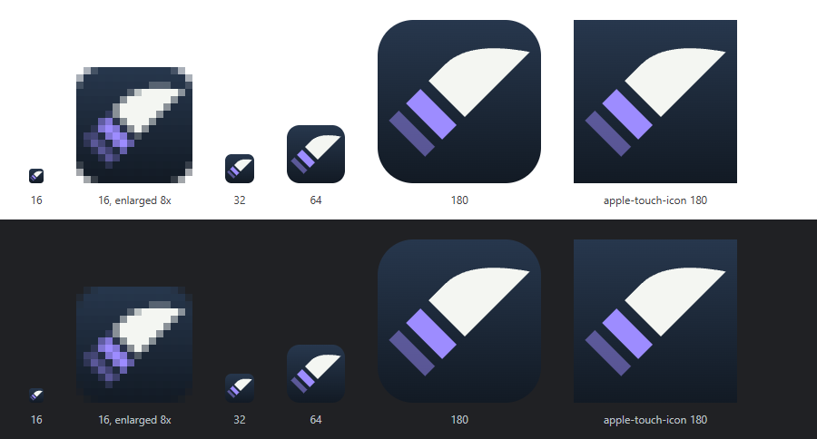
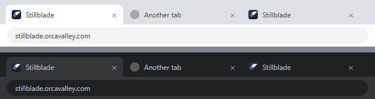

# Browser-tab icon and logo mark






The tab pictures are drawn mock-ups, not screenshots of a real browser's tab bar.

## The mark

A knife blade that breaks into two fading slices: a ghost that stands still disappears. Bone-white blade
(`#f4f6f2`), slices in the ghosts' purple (`#9d8cff`), on a navy rounded square (`#27374d` to `#121a24`). No
letters. Original, hand-written SVG; nothing traced or taken from another game or company.

## Files

| File in `client/public/` | Use |
|---|---|
| `favicon.svg` | The icon in current browsers, and the only drawing: everything else is rendered from it |
| `favicon-32.png`, `favicon-16.png` | PNG fallbacks (`index.html` links the 32 px one) |
| `favicon.ico` | 16, 32 and 48 px, for older browsers |
| `apple-touch-icon.png` | 180 px, square corners (iOS rounds them), no alpha channel |
| `icon-192.png`, `icon-512.png` | Listed in the web manifest |
| `site.webmanifest` | Name "Stillblade", theme colour `#172029` (the menu's navy); `display: browser`, so it does not turn the page into an installable app |

`client/index.html` links them and sets the `theme-color` meta.

## Regenerating

Edit `client/public/favicon.svg`, then:

```powershell
node tools/make-icons.mjs
```

It rewrites the six image files above and `preview.png`, `tab-mock.png` and `tab-mock-2x.png` here, using the
installed Chrome headless (`--chrome <path>` if it is not in the default Windows place). No new dependency. The
`.svg`, the manifest and `index.html` are written by hand. Two runs on the same machine give identical bytes; a
different Chrome version may encode the PNGs differently. The square apple icon is made by removing the `rx` from
the `<rect id="tile">`, so keep that id and attribute.

## Not checked

The icon on a real phone home screen, and in Safari and Firefox.
