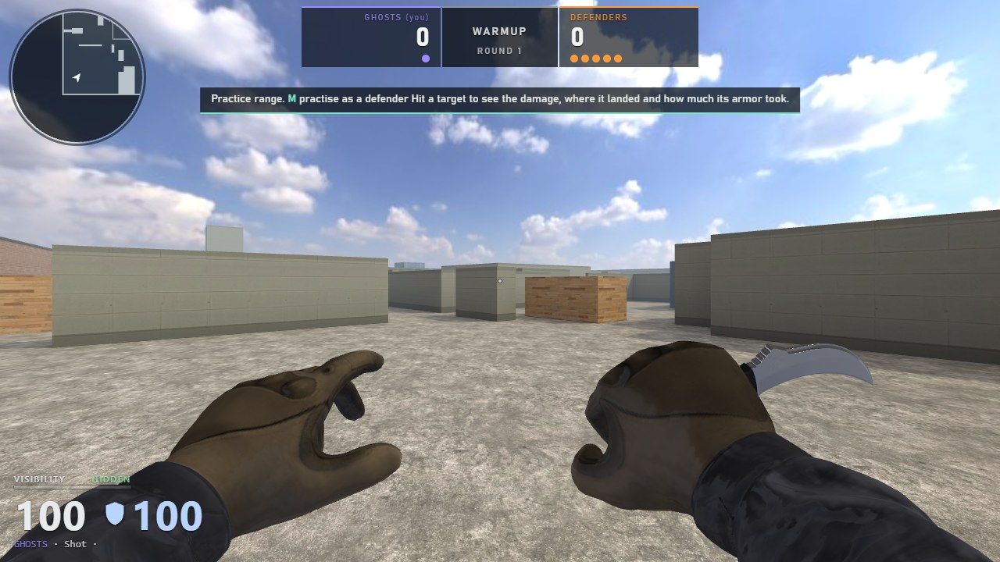
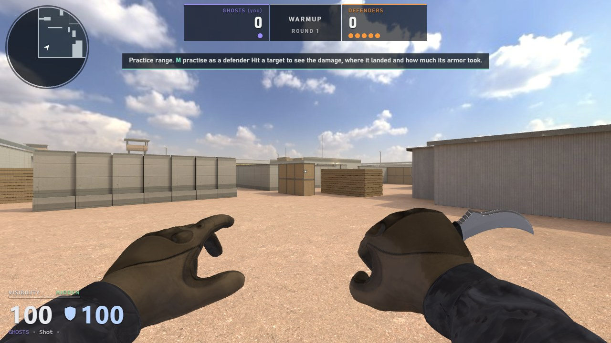
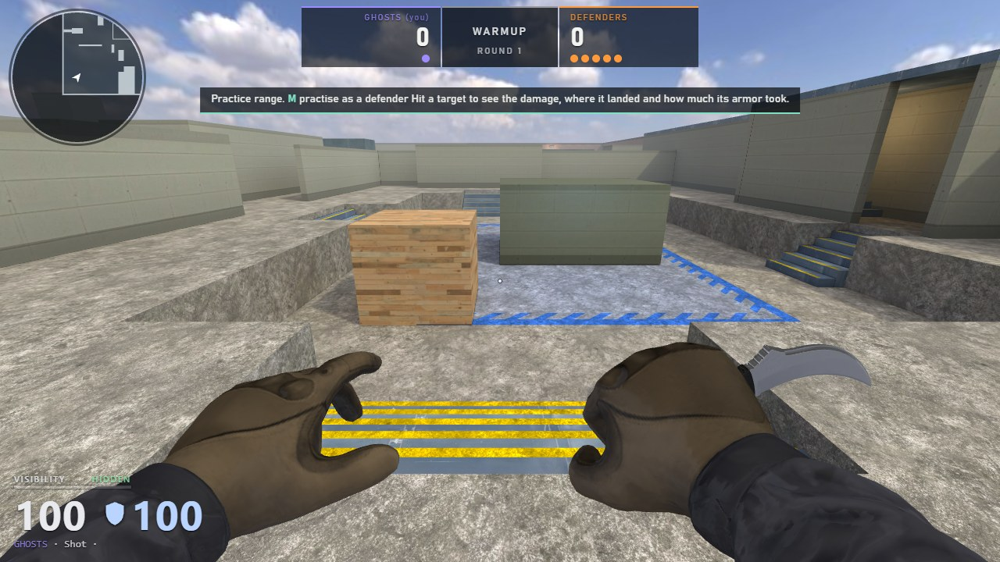
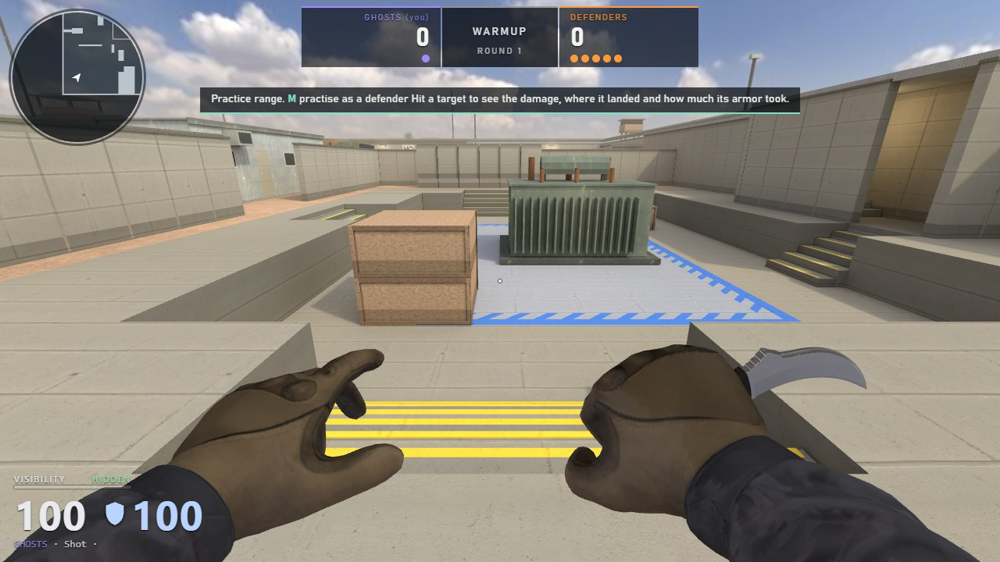
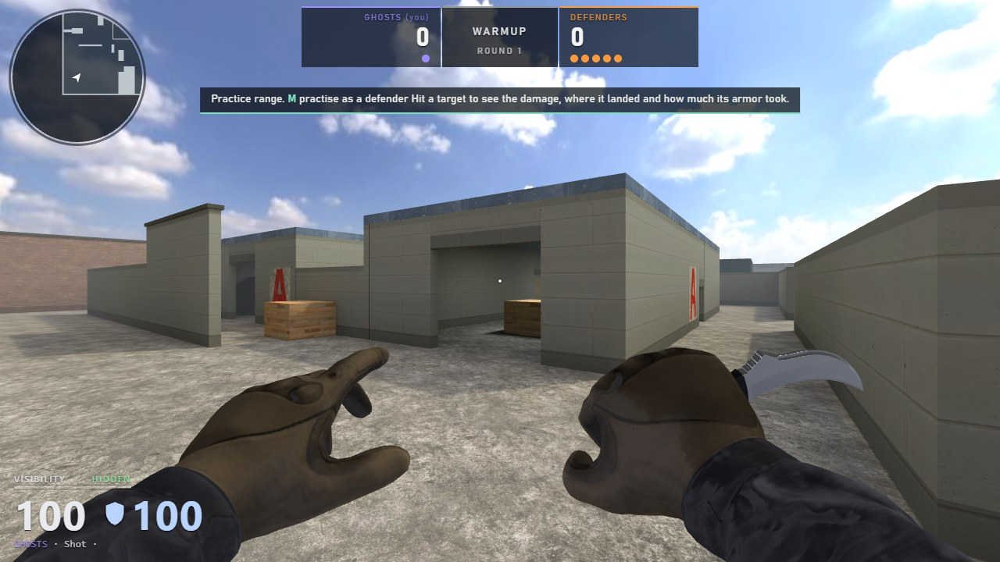
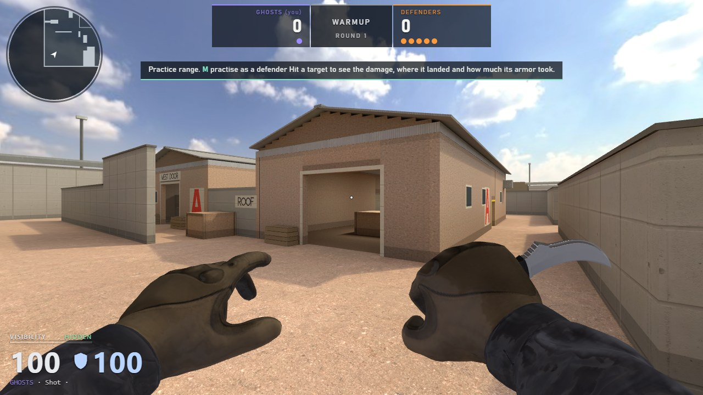
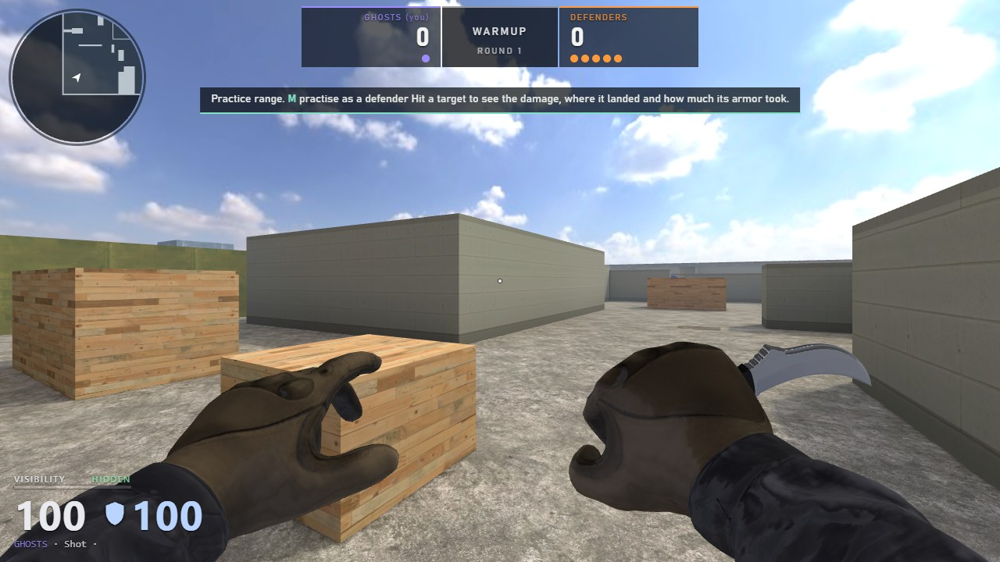
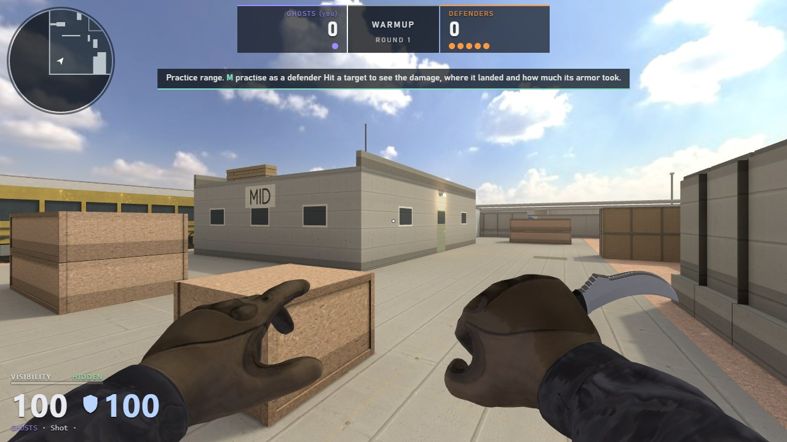

# Dry Creek greybox: build notes for review

Map id `drycreek`, display name "Dry Creek". It is built from the owner-approved plan, draft 4
([`docs/maps/dry-creek/dry-creek-plan-v4.svg`](../../../maps/dry-creek/dry-creek-plan-v4.svg)), and uses the
coordinates in the script that drew it
([`docs/maps/dry-creek/dry_creek_plan_v4.py`](../../../maps/dry-creek/dry_creek_plan_v4.py)).
The definition is [`tools/blender/maps/drycreek.py`](../../../../tools/blender/maps/drycreek.py). It is written in
plan metres (x east, y south) and converted once: authoring X = x - 40, Y = 40 - y; in the engine, x - 40 and
z = y - 40. The acceptance tests are [`server/src/drycreek.test.ts`](../../../../server/src/drycreek.test.ts).

The map is built in two stages of the art package. **Stage 1: real-world heights.** Lane walls and fences come down
from 3.5 m to 2.2 m, buildings, vehicles, containers and tanks take their real sizes, and the sightline blockers
become real objects (commit `3645d9c`). **Stage 2: realistic art** (the next commit): a gritty desert military
outpost, every prop a model, six CC0 materials. Nothing has been merged, pushed or deployed. There is no protocol
change.

## Pictures in this folder

| File | What it shows |
|---|---|
| `00_overhead.jpg` | The built map (stage 2 art) from the real client, from directly above (orthographic from 6 m, north up; the tower's cabin is above the camera) |
| `00_overhead_with_plan_v4.png` | The same, with draft 4's shapes, walls and numbered pins laid over it at exact scale |
| `section_a_roof_route_ew.png` | Site A roof route, east-west through hole 10: box 9, the low roof, the hole, the passage |
| `section_a_passage_ns.png` | Site A, north-south through the passage: south barrack, passage and hole, plant zone |
| `section_b_descent_ew_y47_5.png` | Site B east: walkway, fence opening, top landing, the gantry canopy, and the stairwell wall that blocks the view into the basin |
| `section_b_stairwell_ns_x74_5.png` | Stairwell 23: top landing, plank (0.2 m steps), stairwell floor |
| `section_b_descent_ew_y52_5.png` | Site B east: the full fence, stairwell floor, east stairs, basin, plant zone |
| `01` to `18` `*.jpg` | In-game client screenshots on Low: both spawns, both sites, both crouch gaps (crouched), the roof hole from above and below, box 9, the walkway, the stairwell, the east stairs, the west-edge wall return, A long, mid, B mid (`views.json` and `shots.json` list the camera of each) |
| `01` to `18` `*_high.jpg` | The same 18 views on High (`shots_high.json`) |
| `19` to `21` `*.jpg` | A ghost running at a run's shimmer, seen by a defender: on sunlit sand, in the barrack's shade, on concrete (`ghost_views.json`, `shots_ghost.json`) |
| `before_greybox_*.jpg` | Four views as they were in the stage 1 greybox, for the before/after pairs below |
| `sightlines_over_35m.png` | The collision plan with every clear eye line over 35 m drawn on it (standing and crouched eyes; none is over 40 m), and the 10 longest jump peeks |
| `checker.txt` | Full output of `python tools/blender/mapkit.py drycreek` |
| `tests_drycreek.txt` | Full output of `npx vitest run server/src/drycreek.test.ts`, with every measured number |
| `PLAYTEST.md` | The side-swapped 5 v 5 sheet |

The screenshots were taken with `tools/map-shots.mjs` (headless Chrome with software rendering, against a scratch
server and Vite on scratch ports: 8090 and 5190 for the greybox, 8091 and 5191 since stage 1). Each view used 8 draw
calls with the practice targets hidden. Frame times
from software rendering mean nothing. The sections come from `tools/blender/mapsection.py`
(`sections.json`). The overlay comes from `tools/plan-overlay.py`.

## Stage 2: realistic art

A gritty desert military outpost: sand and gravel underfoot, concrete pads and T-walls, plywood barracks under
corrugated roofs, Hesco bastions, sandbags, painted and rusty vehicles, containers and tanks. Everything is original
and built from boxes in the map's own definition; no layout, texture, logo, sign or landmark comes from another
game. The collision changed for the art only in the two places below (the rest of the box count, 188 to 247, is the
new floors and the tower's legs), so every stage 1 number still holds except one: the defenders' fastest run to A
is 7.3 s instead of 7.2 s, round the sandbags at east door 5. The checker and all 22 acceptance tests pass on the
stage 2 build (`checker.txt`, `tests_drycreek.txt`).

**How it is built.** The pipeline is the same: `tools/blender/maps/drycreek.py` through the shared builder, so a
layout change after the playtest is a rebuild. The new helpers are map-independent and live in
`tools/blender/mapshapes.py`:

- `cylinder` (a round shape from flat facets, as turned visual boxes);
- `Frame` (a prop's local frame on its box);
- prop models: `vehicle` (bus, van, cargo truck, fuel tanker, APV), `container`, `hesco`, `twall_row`,
  `sandbag_wall`, `crate_stack`, `ibc_stack`, `gable_roof`, `flat_roof`.

Each model fills its object's collision box, and the collision box itself is not drawn. So what a player sees
matches what stops them to within a few centimetres, and nothing reaches into player space: the checker shows
**0 visual intrusions** for 2,300 visual boxes. A few things sit above head height on purpose: the barrack roofs'
pitched sheets, the roof kit on the HQ and command post, the AC units (2.2 m and up), the transformer's insulators,
the concertina wire on the perimeter wall, and the guard towers and light poles outside the wall. None of them is
over a spot a player can stand on.

`mapkit.py` gained the rest of the capital letters (and some digits) for painted signs, a per-box lightmap density
(`lm`, so small detail takes fewer texels) and an opt-in to keep a turned box's underside (`under`, for roof sheets
seen from below). `mapbuilder.py` gained a per-map sun warmth and sky tint for the bake.

**Two collision changes in stage 2.**

- **Sandbags at the barrack doors:** five 0.6 m piles against the walls outside west door 22, south door 7 and east
  door 5, each leaving at least 1.9 m of the way in clear. From the top of a pile (0.6 m) nothing new is in reach.
  They are on the checker's list of allowed tops.
- **The watchtower's tower** is now legs and a cabin, not one 4 x 4 m block, so it looks like a tower. It is still
  out of reach: nothing reaches the guard house roof.

**Models.**

| Object | Model |
|---|---|
| School bus | Faded yellow body, window band with pillars and dark glass, windscreen, bumpers, lamps, rub rails, wheels |
| APV | Tan crew box, armour panels, vision blocks, sloped windscreen, turret ring, bull bar, spare wheel, four wheels |
| Van | White box body, bonnet, sloped windscreen, side windows, grille, split rear doors |
| Cargo trucks (3) | Cab with windscreen, chassis, canvas-covered bed with bows, six wheels; olive or tan |
| Fuel tanker | Cab, a 12-facet tank with a walkway and straps |
| Containers (2 x 40 ft) | Corrugated walls 4 cm in from the collision, corner posts, rails, doors with four locking bars; rust red and faded blue |
| Fuel tanks (4) | 14-facet horizontal tanks on concrete saddles, a decorative ladder (not climbable: it is inside the tank's collision), valves |
| Hesco bastions (11) | Fabric-lined body, wire posts at every cell joint and rails round the top and middle, sand fill on top |
| T-walls (5 rows, the 3.4 m gate) | Panels with a foot, a narrower top and dark joints |
| Lane and perimeter walls | Concrete with a T-wall panel joint every 1.25 m (1.6 m on the perimeter) and a capping strip; concertina wire on the perimeter |
| Barracks | Plywood walls, plywood floors, corrugated gable roofs (no overhang toward the low roof), windows, door frames, yellow-framed crouch gaps, ceiling lamps |
| HQ, command post | Concrete, windows on every side, AC units, a roof parapet; HQ: roof plant, a mast and a dish; command post: a sandbag ring and a mast |
| Garage, pump hut, generator shed | Corrugated sheds; the garage's two roll-up doors, the shed's louvres and exhaust stacks, the pump hut's pipe |
| Office trailers, guard hut | Painted cabins with windows, doors and AC units |
| Watchtower | Guard house with a flat roof; steel legs with braces, a plywood lookout cabin with a dark window band, a corrugated roof |
| Water tank (barrack roof) | A dark tank on a steel stand |
| Site B transformer | Skid, tank, cooling fins along both sides, a conservator, six bushings, a warning plate |
| Site A console | Four radio and control racks with screens, switch rows, vents and handles on every face |
| Crates, jump boxes | Plywood crates with corner battens and rims |
| IBC tanks (5 stacks) | White tanks in steel cages on pallets, two high |
| Sandbag walls (3, plus the door piles) | Courses that step in and out |

**Materials and budget.** Six surface materials, all CC0 from Poly Haven (`client/public/maps/CREDITS.md`): sand
and gravel (`gravelly_sand`), concrete (`concrete_wall_004`, processed warmer), corrugated sheet
(`corrugated_iron_02`), painted metal (`green_metal_rust`), plywood (`oriented_strand_board`) and fabric
(`hessian_230`). Colour comes from per-box tints, so one painted-metal texture gives the bus, the APV and the
containers their colours. Floors are no longer all sand: concrete pads (parade ground, motor pool, the defender
spawn, the apron round Site B's pit, the passage) and plywood in the barracks.

| Budget item | Stage 1 greybox | Stage 2 art | Limit |
|---|---|---|---|
| World draw calls (Low) | 6 + sky | **7 + sky = 8** (six materials and the paint) | 8 |
| Texture reads per world pixel | 2 | **2** (albedo and lightmap; the shader is unchanged) | 2 |
| On screen in the 18 views | 8 on Low | **9 on Low** (the world, the sky and the first-person knife), **31 on High** | |
| Collision boxes / visual boxes / lamps | 188 / 14 / 11 | 247 / 2,301 / 20 | |
| GLB | 749,332 bytes | **3,021,200 bytes** (77,260 vertices, 38,630 triangles; Warehouse: 32,188 and 16,094) | `max_glb_bytes` 3 MB (3,145,728): not raised |
| Lightmap | 4096², 394,720 bytes | **4096², 944,744 bytes**, 27 texels per metre (3.7 cm per texel) where players look, 76% of the atlas in islands; about 85 MB of GPU memory with mipmaps | |
| Textures | five shared greybox textures | **six new 1024² WebP, 1,054,138 bytes**: sand 321,288, concrete 103,926, corrugated 91,892, painted metal 58,406, plywood 216,670, hessian 261,956 | |
| JSON | 444,259 bytes | 457,188 bytes | |
| Whole download (with the shared sky) | 2.36 MB | **5.33 MB** (5,587,684 bytes; Warehouse 3.5 MB) | |
| Bake (RTX 4060, 1024 samples, 4 bounces) | 284 s | **331 s** (the build 357 s, plus the checker's few minutes) | |

**Lighting.** Baked in Cycles like the other maps, with the same CC0 sky. A new sky HDRI would move the sun, and
the sun's direction is shared with the players' lighting (`client/src/lighting.ts`). So Dry Creek warms the sun
(`sun_warmth` 1.0, 0.9, 0.72) and the sky's light in the bake, and adds sodium lamps on the buildings and under the
gantry canopy. The client look (`maplook.ts`) is a dusty warm haze (fog 0.74, 0.64, 0.50 from 16 m), slightly
faded colour and a warm gain.

**Readability.**

- The large A and B letters, the site fills and the hazard bands are kept from the greybox.
- Wall signs mark each site's ways in.
- Callouts are painted on boards on the walls players come in by: A LONG, A SHORT, ROOF, WEST DOOR, EAST DOOR,
  FLANK, B MID, B NORTH, B SOUTH, WALKWAY (the playtest sheet's route names), plus GARAGE, MID, HQ, FUEL and TOWER.
- Yellow nosing on every stair, yellow edges on the drops, yellow frames on the crouch gaps.
- The cover models stay within their boxes and have no loose detail on their edges.

**Footsteps.** `client/src/effects.ts` `surfaceOf` now maps the new categories:

- plywood (barrack walls and floors) to **wood**;
- sheds, cabins, containers, machines, roofs, the walkway and the gantry to **metal**;
- sand (`floor`), concrete pads, Hesco and sandbags to **concrete**.

There is no sand or gravel footstep set, so the sand reuses concrete, the nearest one. No new audio was added.
A test covers the mapping (`client/src/graphics.test.ts`).

**Ghost shimmer.** `tools/map-shots.mjs` can now draw one ghost running along a line at a run's opacity (0.35), in
the presenter only, from a defender's page (`--side defenders`, views in `ghost_views.json`):

- `19_ghost_running_sunlit_sand.jpg`: on sunlit sand;
- `20_ghost_running_shade.jpg`: in the shade inside the south barrack;
- `21_ghost_running_concrete.jpg`: on the parade ground's concrete in full sun.

In all three the ghost reads as a pale moving outline: against sunlit sand it is a faint grey figure, in the
barrack's shade a lighter one against the plywood, on the concrete the faintest of the three. How easy it is to spot
in motion, at speed and at a distance, needs people (playtest).

**Before and after (stage 1 greybox, then stage 2, Low):**

| Before | After |
|---|---|
|  |  |
|  |  |
|  |  |
|  |  |

The 18 views are in this folder on Low (`01` to `18`) and on High (`*_high.jpg`).

## Stage 1: real-world heights (every height and footprint changed)

The owner asked for walls about 1.2 times a person's height, so the map no longer feels enclosed, and for the
vehicles, containers and tanks at their natural sizes.

| What | Draft 4 greybox | Stage 1 | Footprint |
|---|---|---|---|
| Lane and compound walls, the B walls, the dividing walls | 3.5 m | **2.2 m** (1.2 x 1.8 m) | unchanged |
| B east fence and the stairwell walls | 4.7 m (3.5 m above the walkway) | **3.4 m** (2.2 m above the walkway) | the fence now also runs along the walkway's two stairs (y 30 to 34, 64 to 68) |
| Outer (perimeter) wall | 4.0 m | 4.0 m, unchanged: it is the map's edge, and a 2.2 m edge would be one 1.8 m crate away from a way out | unchanged |
| Barracks | walls 3.5 m, roof slab 3.3 to 3.5 m inside the walls | walls **3.2 m**, roof **3.2 to 3.45 m** over the whole outline (no wall top is left bare) | unchanged |
| Room between the barracks (x 34 to 38) | 3.5 m | **3.45 m**, with a **water tank on its roof** (3.45 to 4.6 m) | tank 3.7 x 3.4 m |
| Low roof, passage roof, hole 10, crouch gaps 6 and 8, passage headroom | 2.05 m, 1.9 m clear, 1.4 m | unchanged | unchanged |
| A yard west wall, the 5.5 m nearest A long (y 14.5 to 20) | 3.5 m | **3.4 m tall T-walls** (the rest of that wall 2.2 m), see below | unchanged |
| HQ, garage | 3.5 m | 3.5 m | unchanged |
| Command post | 3.5 m | **3.3 m** | unchanged |
| Pump hut and its annex, generator shed | 3.5 m | **3.0 m** | unchanged |
| Office trailers (mid) | 3.5 m | **2.9 m** | unchanged (3 x 10 m) |
| Guard hut (the walkway's north end) | 3.5 m | **2.8 m** | unchanged |
| Watchtower | a 3.5 m block | a **3.2 m guard house** on the drawn footprint, with the **tower (4 x 4 m, to 9.0 m)** on its south-east corner; nothing reaches the guard house roof | unchanged |
| School bus | 3.0 m | 3.0 m, 2.5 m wide | unchanged (12 x 2.5 m) |
| APV | 2.4 m | **2.7 m** | unchanged (3 x 6 m) |
| Van | 2.5 m, 3 m wide | **2.1 m**, **2.1 m wide** | **changed**: 2.1 x 5.0 m on the drawn centre line (x 12.45 to 14.55) |
| Containers (defender side) | one 10 x 6 m block, 3.5 m | **two 40 ft ISO containers side by side, 2.6 m** | **changed**: 12.19 x 4.88 m on the drawn centre (x 60.9 to 73.1, y 18.6 to 23.4) |
| Fuel tanks (2 drawn, 6 x 6 m each) | 3.5 m blocks | **two horizontal tanks per drawn tank**, 3.0 m across on 0.3 m saddles, 3.3 m at the top; the collision follows the round profile in three boxes (the sides 2.8 m) | unchanged |
| Cargo trucks (3) and the fuel tanker | 3.0 m | **3.2 m**, 2.5 m wide | the tanker 2.9 to 2.5 m wide |
| Site B transformer, Site A console | 2.2 m | 2.2 m (hard cover) | unchanged |
| Jump boxes, human cover | 1.0 m, 1.8 m | unchanged | the south lane's jump box moved 1 m west (below) |

**Gantry canopy over the walkway (new).** With the fence at 2.2 m above the walkway, a jumping player's eye (2.79 m
above the walkway) clears it, and the acceptance check "no line of sight from the walkway to the B plant zone"
includes the top of a jump. A corrugated canopy rests on the fence, 2.0 m wide (x 75.4 to 77.4) over the walkway and
both its stairs, with 2.2 m of headroom: under it a jump stays below the fence top. Farther out a jump clears the
canopy (eye 3.99 m), but then the canopy itself hides the basin: a line over the canopy's edge (3.6 m) and down to
a point of the plant zone has to drop 3.5 m over at most 17 m of x, so it only clears the canopy from an eye closer
than x 77.0, which is still under the canopy. The test now simulates each jump with the shared movement code (so a
roof stops it) and still finds **0 clear lines** from 1,593 eye points. The stairwell is roofed at 3.4 m. A full
roof over the whole walkway also passed but made it a dark tunnel (the first stage 1 build had it).

**Tall T-walls at the A long end of the yard's west wall (new).** At 2.2 m that stretch is 2.75 m from the low
roof's edge, and a running jump crosses 3.35 m to a top 0.15 m higher (`tools/mount_check.ts`, new gap-jump
table). From that wall top every 2.2 m wall in the map is a walk or a jump away. The 5.5 m nearest the low roof
are 3.4 m tall T-walls, which no jump from the roof reaches.

**South lane jump box moved 1 m west.** Drawn, its edge was 2.9 m from the corner of the 1.8 m crates beside it,
inside a running jump to a top 0.8 m higher (2.75 m plus the checker's 0.15 m margin). From the crates' top every
2.2 m wall top is a mount (1.8 + 1.16 m).

### New checks in the checker

- **Crouched eyes** join standing eyes in the 40 m sightline test (`m.sightline_crouched`).
- **Jump peeks** (report only, `m.jump_peek_report`): eye points at the top of a jump (1.17 m higher; under a
  ceiling, where the ceiling stops it) against every standing, crouched and jumping eye. The 10 longest, at least
  4 m apart at both ends, in plan metres:

  | Length | Jumping eye at | Sees |
  |---|---|---|
  | 90.1 m | the walkway's open side (79.1, 33.9), 3.99 m | a standing eye at the ghost spawn's south-west corner (1.1, 78.9) |
  | 87.9 m | the walkway (79.1, 38.4), 3.99 m | a crouched eye at (1.1, 78.9) |
  | 87.9 m | the walkway (79.1, 33.9), 3.99 m | a standing eye at (1.1, 74.4) |
  | 87.2 m | by the east wall (79.1, 75.9), 2.79 m | a jumping eye in the west lane (1.1, 36.9) |
  | 86.2 m | the walkway (79.1, 33.9), 3.99 m | a crouched eye at (5.6, 78.9) |
  | 86.0 m | the walkway (79.1, 42.9), 3.99 m | a crouched eye at (1.1, 78.9) |
  | 85.9 m | the walkway (79.1, 38.4), 3.99 m | a standing eye at (1.1, 74.4) |
  | 85.9 m | the walkway (79.1, 33.9), 3.99 m | a jumping eye at (1.1, 69.9) |
  | 85.9 m | the south wall (43.1, 78.9), 2.79 m | a jumping eye at the defender spawn's corner (79.1, 0.9) |
  | 84.7 m | by the east wall (79.1, 74.4), 2.79 m | a jumping eye in the west lane (1.1, 41.4) |

  These are corner-to-corner diagonals over the 2.2 m walls. The owner accepts jump peeks by design; they do not
  fail the build.
- **Strict spawns** (`m.strict_spawn_sight`): from every spawn point's standing, crouched and jumping eye, no clear
  line to the other spawn (bodies and eyes, jumping too) or to any point of either plant zone (0.5 m grid, 0.1,
  1.0 and 1.7 m up). **0 clear lines.** `drycreek.test.ts` checks the same with simulated jumps.
- **Unintended perches** (`m.allowed_tops`): a worst-case reach that mounts ledges up to 1.18 m (measured 1.16 m)
  and makes running jumps across gaps from the edge of any raised top, using the measured gap table plus 0.15 m.
  Every top it reaches must be a floor, a stair, a platform or listed (the jump boxes and the low roof). **It
  reaches nothing else:** 0 spots more than the ordinary walk graph. Before the two fixes above it reached every
  wall top in the map.

### Sightline blockers as real objects

With 2.2 m walls the old blockers still matter (lines between standing eyes stay under a 2.2 m wall), and the
raised spots now see over walls: the low roof (eye 3.67 m), the jump boxes (2.62 m), the walkway and its stairs. I
listed every clear line over 40 m with no blockers at all (**72,435** lines, standing and crouched eyes, 1.5 m
grid) and chose objects from a list of candidates by greedy set cover, then dropped any the rest made
unnecessary. The result is 30 objects plus the water tank, each at its own natural height:

| Kind | Height | Objects |
|---|---|---|
| Hesco bastions | 2.2 m | `x_w_wall_return`, `x_n_pillar`, `x_a_blast_wall`, `x_m_north_block`, `x_m_north_post`, `x_s_block_w`, `x_s_block_e`, `x_s_alley_wall`, `x_s_spawn_pillar`, `x_m_south_post`, `x_d_barrier` |
| Concrete T-wall rows | 2.5 m | `x_w_spawn_screen`, `x_b_mid_blast_wall`, `x_b_north_blast_wall` (now from x 59.0, was 61.5), `x_m_fuel_blast_wall`, `x_m_garage_blast_wall` (moved 0.6 m east, to x 20.2 to 20.8) |
| IBC tanks, two high | 2.3 m | `x_s_alley_block`, `x_s_shed_block`, `x_d_post_w`, `x_d_post_e` (moved to x 58.4 to 59.4, clear of the containers), `x_d_post_s` |
| Supply crates | 1.8 m | `x_w_garage_pile`, `x_e_walkway_crate_n`, `x_e_walkway_crate_s` (on the walkway) |
| Trucks | 3.2 m | `x_w_truck` (west lane); **`x_m_nw_truck`** (new: mid's north-west pocket along the lane wall, x 18.1 to 20.5, y 35.6 to 43.0; the low roof looked down the lane wall's mid side to the ghost spawn, 60 m); **`x_d_truck`** (new: the pocket north of mid's north wall, x 46.0 to 53.4, y 27.9 to 30.4; the defender side's jump box looked over the yard wall, down the yard's south strip and out of A long, 54 m); `x_s_tanker` |
| Buildings | 2.8, 3.0 m | `x_e_guard_hut`, `x_s_pump_annex` |
| Water tank | to 4.6 m | `a_rooftop_tank` on the room between the barracks (the passage roof looked east over the room to the walkway's stairs, 48 m) |

Dropped: `x_w_flank_block`, `x_s_spawn_crates` and `x_m_west_post` (the others cover their lines).
`sightlines_over_35m.png` shows every clear line over 35 m (832, longest 39.6 m) and the 10 jump peeks.

### Before and after (draft 4 greybox, then stage 1)

| Measure | Before | After |
|---|---|---|
| Longest sightline (stage 1 adds crouched eyes) | 39.6 m | 39.6 m |
| Walking path, ghosts to A / B | 69.1 / 66.6 m | 69.1 / 66.6 m |
| Walking path, defenders to A / B | 40.7 / 42.6 m | 40.7 / 43.6 m |
| Route paths A: door 7, west door 22, A short, roof, flank 6, east door 5 | 71.4, 69.1, 70.1, 76.7, 79.8, 80.6 m | 71.4, 69.1, **74.9**, 76.7, 79.8, **81.8** m |
| Route paths B: mid, south, north, walkway | 66.6, 70.0, 87.5, 104.5 m | 66.6, 70.0, **89.4**, **107.1** m |
| Console: spots seeing all three entries / the west door and the passage / both on screen at once | 316 / 435 / 124 of 778 | 316 / 435 / 124 of 778 (the room is unchanged) |
| Run, ghosts to A / B | 13.6-14.0 / 12.6-13.7 s | 13.6-13.9 / 12.6-13.6 s |
| Run, defenders to A / B | 7.2-8.4 / 8.6-8.8 s | 7.2-8.4 / **8.8-9.1** s |
| Quiet walk, ghosts to A / B | 26.5-27.5 / 25.1-27.2 s | 27.1-27.7 / 25.1-27.1 s |
| Quiet walk, defenders to A / B | 14.4-16.7 / 17.1-17.5 s | 14.4-16.7 / 17.4-18.1 s |
| First contact: A long (door 7, door 22), A short, roof, flank, B mid, B south, walkway | 9.1, 8.8, 7.2, 8.8, 8.8, 8.2, 11.1, 9.8 s | 9.1, 8.8, **9.2**, 8.8, 8.8, 8.2, 11.2, 9.8 s |
| Collision boxes / world draw calls | 174 / 6 + sky | 188 / 6 + sky |
| Download | 2.42 MB | 2.36 MB |

A short is longer because the new truck in mid's north-west pocket and the garage T-walls (moved 0.6 m east) sit
on the ghosts' way; first contact on A short moves from 7.2 s to 9.2 s for the same reason. The defenders' B time
grows by 0.2 to 0.3 s round the longer containers.

## Checker (mapkit) results

All checks pass, with `max_sightline` set to 40 m (stage 1 numbers).

- **Longest sightline: 39.6 m**, eye to eye on a 1.5 m grid, standing and crouched eyes. It runs from a crouched
  eye on the defender side (79.1, 21.9) to a standing eye in mid's north strip (43.1, 38.4).
- **Spawn sightlines:** 0 of 25 ghost-to-defender eye pairs are clear, and the strict check (standing, crouched and
  jumping eyes against the other spawn and both plant zones) finds 0 clear lines.
- **Perches:** the worst-case reach finds no top beyond the floors, stairs, platforms, jump boxes and the low roof.
- **Gaps and headroom:** no gap under 1.4 m, no overlap, nothing stuck. 0 reachable spots have less than 2.0 m
  of headroom outside the three allowed low ceilings. Crouch gaps 6 and 8 are 1.40 m clear and crouch-only. The
  passage is 1.90 m clear: standing room, but no jumping.
- **Stairs:** 7 flights, every rise 0.2 m, every one climbable on foot from its bottom step.
- **Navigation graph:** 5,378 nodes and 36,941 links (64 jump, 311 drop, 24 crouch). Every node is reachable from
  a spawn, and every spawn reaches both sites and back.
- **Walking path, spawn to site:** ghosts 69.1 m to A and 66.6 m to B; defenders 40.7 m to A and 43.6 m to B.
- **Distinct routes.** For each route, the checker opens only that route's gate and closes all the others. Each
  route alone gets the ghosts into the site, and with every gate closed the site is unreachable. Shortest ghost
  path through each:

  | Site | Route | Path |
  |---|---|---|
  | A | A long, south barrack door 7 | 71.4 m |
  | A | west door 22 | 69.1 m |
  | A | A short, crouch gap 8 | 74.9 m |
  | A | box 9, low roof, roof hole 10 | 76.7 m |
  | A | north crouch gap 6 (watchtower flank) | 79.8 m |
  | A | east door 5, round the yard | 81.8 m |
  | B | B mid | 66.6 m |
  | B | B south | 70.0 m |
  | B | B north | 89.4 m |
  | B | walkway, stairwell 23, plank | 107.1 m |

  The east door (5) had to be added as a sixth A gate. The north barrack also opens east onto the yard, and the
  yard is one connected space round both barracks, so without that gate the "every gate closed" check fails.

- **Build (stage 1):** 188 collision boxes and 14 visual-only boxes. The world is 6 draw calls plus the sky; the
  Low-tier budget is 8.
- **File sizes (stage 1):** GLB 0.75 MB, JSON 0.44 MB, lightmap 0.39 MB (4096², 1024 samples, about 280 s bake on
  the RTX 4060). The whole map downloads as 2.36 MB with the shared textures. The shared texture files came out
  byte-identical.

## Acceptance checks (server/src/drycreek.test.ts, 22 tests, all pass)

**Site A.** Every route is walked with `stepPlayer` along the nav graph.

- West door 22 reaches the console.
- A short reaches it through crouch gap 8 (a crouch link), the south barrack and the passage.
- Box 9 to the low roof takes two jump links. From the roof, the walker drops through hole 10 into the passage
  and reaches the console. The hole is one way: the way back up is box 9.
- Crouch gaps 6 (the watchtower flank) and 8 are passable crouched and blocked standing, in both directions.
- A standing player fits in the passage and cannot jump there.

**Console visibility.** This sweeps 778 free standing spots within 2.5 m of the console. Each ghost entry is
represented by body points at 1.0 m and 1.7 m: in west doorway 22, at the passage mouth (where A short arrives),
and under roof hole 10.

| What one spot sees | Spots |
|---|---|
| west door + passage mouth + under the hole (all three) | 316 |
| west door only | 234 |
| west door + passage mouth | 119 |
| passage mouth + under the hole | 106 |
| none | 3 |

So **a defender at the console can see all three entries from one spot**: 316 of the 778 spots, 41%.

Seeing them is not the same as watching them at once, though. From those 316 spots, the west door and the
passage mouth are 58° to 180° apart (median 138°). The default view is about 107° wide on a 16:9 screen. **Only
124 of the 778 spots have both on screen together**, mostly the corners of the room behind the console. Everywhere
else the defender has to turn between the west door and the passage.

A short and the roof hole both come into the room through the passage, so the console has two directions to
watch, not three. Draft 4's claim that "long, short and roof come from different angles" is only half true. Long
(west door 22) is a separate angle; short and roof share the passage. The playtest sheet asks whether that is
enough to split a defender's attention.

**Site B east.** The walker goes walkway → top landing → plank → stairwell floor → east stairs → basin, and back
again, with no drop or jump link.

**Walkway line of sight.** Eye points are taken over the walkway, its end stairs and the top landing: standing,
crouched and at the top of a jump, 1,593 in all. Since stage 1 the jump is simulated with the shared movement code
from each spot, so the canopy stops it where it covers the spot (the highest jumping eye is 3.99 m, on the open
side). They are tested against 1,035 points of the B plant zone, at 0.1, 0.9 and 1.7 m above the basin floor.
**0 clear lines.** The fence and the stairwell walls stand 2.2 m above the walkway; the canopy and the stairwell
roof rest on them.

**Planting at B.**

- Planting works at the closest legal point to each of the four rims, which is 2.5 m in, and fails 5 cm nearer.
- No standing spot at ground or walkway height is inside the site box. The box top is at -0.3 m, under the
  0.0 m rim.

**Defusing at B, with `canAct`.**

- I checked 39,843 standing spots at ground and walkway height, 0.1 m apart: the rim (including spots
  overhanging it by up to half the hull), the stair tops, the stairwell floor, the walkway and the top landing.
  None can defuse any legal bomb spot on the plant zone's edge.
- The closest any of them gets is **2.30 m**; defuse range is 1.6 m.
- Below the rim, 405 spots on the basin's 1.0 m jump box can defuse: it stands in the basin beside the zone's
  north-east corner. **0 stair steps can.**
- Defusing works from the basin floor next to the bomb.

**Spawns.** Neither spawn sees the other spawn or any point of either site, from a standing, crouched or jumping
eye (the jump simulated).

**Timing from the actual spawn points.** Each walker follows the nav path from all five spawn points with
`stepPlayer`. The clock stops at the first moment the walker stands in the plant zone.

| | Run (fastest / slowest spawn) | Quiet walk |
|---|---|---|
| Ghosts to A | 13.6 / 13.9 s | 27.1 / 27.7 s |
| Ghosts to B | 12.6 / 13.6 s | 25.1 / 27.1 s |
| Defenders to A | 7.2 / 8.4 s | 14.4 / 16.7 s |
| Defenders to B | 8.8 / 9.1 s | 17.4 / 18.1 s |

Defenders reach each site about 5 s (A) and 4 s (B) before a running ghost.

**First contact on each main route.** A ghost runs from the middle ghost spawn point by the route. Defenders run
from their spawn; the time to every nav node is worked out over the graph at 5.2 m/s (2.0 on crouch links).
First contact is the first moment that some spot a defender could have reached by then has a clear eye-to-body
line to the ghost. Ghost invisibility is ignored, so this is the earliest a defender could see a ghost, not when
they would.

| Route | Ghost in the site | First contact | Ghost at | Seen from |
|---|---|---|---|---|
| A long, door 7 | 14.0 s | 9.1 s | west lane at the A long opening (15.9, 32.1) | the A yard's south strip (35.9, 30.1) |
| A long, west door 22 | 13.2 s | 8.8 s | the same spot (12.5, 32.5) | the A yard's south strip (38.9, 29.1) |
| A short, crouch 8 | 15.5 s | 9.2 s | mid, west of the command post (29.7, 39.7) | mid's north strip (41.9, 39.6) |
| Box 9, roof, hole 10 | 16.8 s | 8.8 s | A long opening (13.5, 32.4) | A yard south strip (38.9, 29.1) |
| Flank 6 | 18.1 s | 8.8 s | A long opening (12.5, 32.5) | A yard south strip (38.9, 29.1) |
| B mid | 13.2 s | 8.2 s | mid south (43.1, 57.2) | mid north, by the trailers (46.1, 37.1) |
| B south | 13.8 s | 11.2 s | south lane by the tanker (60.5, 65.2) | B's east strip, through B south (72.1, 58.1) |
| Walkway, plank | 21.0 s | 9.8 s | back alley (54.4, 72.1) | B's east strip, through B south (74.1, 52.1) |

All A routes from the west lane are first visible at the A long opening. A defender in the yard's south strip
looks west along it, across the opening, into the west lane. That is the first fight point on A.

**Bots.** `bots.test.ts` now covers Dry Creek alongside the other maps, and all pass:

- every spawn has a nav path to both sites;
- a ghost bot carries the bomb to A and to B and plants each;
- a defender bot goes to a bomb on each site and defuses it;
- the practice range faces each team's spawn at its target.

## Every change from draft 4, with the reason

1. **Walls are real thickness.** Wall lines are 0.25 m walls centred on the drawn line. The outer wall is 4.0 m
   tall and 0.5 m thick, outside the 80 m square. Where walls meet, one runs on to the other's far face.
2. **West lane / mid wall starts at y 32, not 34.** The drawn wall left an unlabelled 2 m gap at y 32 to 34. It
   was a second, unmarked way from the west lane to A short, north of the school bus.
3. **B's south-west pocket is filled solid** (x 54 to 56, y 60 to 64). The drawn mid/south wall stopped at x 54
   and B's west wall at y 60, which left a 2 m gap into a pocket open to B: an unmarked fifth way into B.
4. **B's north and south walls run on to the fence.** They were drawn ending 0.5 m short of it, leaving a slot.
5. **Box 9 is pushed against the low-roof block and is 1.35 m deep.** It was drawn 1.5 x 1.5 m, 0.3 m off the
   wall, with 1.1 m to the yard wall: two slots under the 1.4 m minimum.
6. **Five cover pieces were pushed against walls**, because each was drawn 1.1 to 1.4 m off a wall:
   - A's north-west cover, moved 5 cm east and onto the north wall;
   - A's south-east cover, into the corner;
   - the south barrack's south-east cover, into the corner;
   - the console and the barrack jump box needed nothing.
7. **Heights the plan implies** (stage 1 changed several; the table above has every one):
   - The barracks have roofs (stage 1: walls 3.2 m, roof 3.2 to 3.45 m).
   - Under the low roof (x 21 to 30) is a closed block.
   - The low roof is 2.05 m, a 0.15 m slab. It is reachable only from box 9: tools/mount_check.ts measures 1.16 m
     from the ground and 2.16 m from a 1.0 m box. The passage under it is 1.9 m clear.
   - The barrack walls are closed above the passage by lintels from 1.9 m to the eaves, so nobody drops from the
     roof straight into a barrack.
   - Doors 5, 7 and 22 have lintels at 2.4 m.
   - Crouch gaps 6 and 8 are 1.4 m wide and 1.4 m clear.
8. **B east: a stairwell instead of the open 6 m plank opening.** This was review item 4, and the check "no line
   of sight from the walkway to any point of the plant zone". The drawn opening looked straight down the plank
   and the stairs into the basin.
   - The fence is a solid wall with its 1.78 m opening at the south end, y 46.6 to 48.4. Draft 4 greybox: 4.7 m
     (3.5 m above the walkway). Stage 1: 3.4 m (2.2 m above the walkway) under the gantry canopy.
   - Behind it is a closed stairwell in the drawn plank's footprint (x 73.5 to 75.5, y 46.5 to 53.5). It holds a
     top landing at walkway height, the plank (five 0.2 m steps, 1.75 m wide, going north), and an opening at its
     north-west corner (y 51.6 to 53.4) onto the east stairs.
   - The way in and the way out are offset, so no straight line passes through both into the zone.
9. **The east stairs are 2.0 m long and 1.78 m wide.** They were drawn 1.5 m long and 4 m wide at x 72 to 73.5,
   y 49 to 53. Five 0.4 m treads of 0.2 m need 2.0 m, so they start 0.6 m inside the basin (x 71.4 to 73.4, y
   51.6 to 53.4).
10. **The walkway's end pads are stairs:** five 0.2 m steps on 0.8 m treads, over the drawn 4 m pads.
11. **Site boxes are 0.9 m tall.** B's top is -0.3 m, under the rim. At A this means nobody plants standing on a
    1.0 m box.
12. **Sightline blockers** (the draft 4 greybox's 31; stage 1 replaced them with 30 real objects and a water tank,
    listed in "Sightline blockers as real objects" above). This was review item: no line over 40 m. Draft 4 left about 19,000 clear eye-to-eye
    lines of 40 to 79 m on the checker's 1.5 m grid, not only the west-edge strip the review found. They ran down:
    - the west strip (x 12 to 18) from the north wall to the ghost spawn;
    - the walkway and the east edge;
    - the south lane, end to end;
    - mid's north strip, from the defender side into the west lane;
    - the defender side through the yard gap and east door 5 across Site A (57 m);
    - both B gaps;
    - a 79 m diagonal from the ghost spawn through the fuel gap, B mid and over the basin.

    Each piece is named `x_...` in the definition. In the draft 4 greybox all were 3.5 m tall except where noted:

    | Corridor | Pieces |
    |---|---|
    | West edge, south of the Garage (the review's 48 m line) | `x_w_wall_return`: a wall from the west wall to the drawn cover |
    | West strip | `x_w_flank_block` beside the watchtower; `x_w_truck` (3.0 m) parked across the lane from the mid wall, 1.5 m short of the APV; `x_w_spawn_screen` north of the ghost spawn; `x_s_spawn_crates` (1.8 m) and `x_s_spawn_pillar` at the spawn's east exit; `x_w_garage_pile` (1.8 m) under the Garage |
    | North strip | `x_n_pillar` against the north wall |
    | Site A east door | `x_a_blast_wall` in the yard in front of door 5 |
    | Mid | `x_m_north_block` and `x_m_north_post` (an L in the north strip); `x_m_west_post` beside the garage gap; `x_m_garage_blast_wall` and `x_m_fuel_blast_wall` on the mid side of the garage and fuel gaps; `x_m_south_post` against the south wall |
    | B | `x_b_mid_blast_wall` west of B mid, against the east trailer (B mid is now entered from the north between the trailer and B's wall, or from the south round the blast wall, through 1.8 to 2.4 m); `x_b_north_blast_wall` inside B north |
    | Walkway and east edge | `x_e_guard_hut` before the walkway's north stairs; `x_e_walkway_crate_n` and `_s` (1.8 m, on the walkway), offset so no line runs its length; they are also cover up there |
    | South lane | `x_s_block_w` and `x_s_block_e`; `x_s_tanker` (3.0 m) between the east tank and B's south wall; `x_s_alley_wall` and `x_s_alley_block` in the back alley; `x_s_shed_block` on the generator shed; `x_s_pump_annex` on the pump hut |
    | Defender side | `x_d_barrier`, `x_d_post_w`, `x_d_post_e`, `x_d_post_s` |

    The checker's sightline test uses standing and crouched eyes on a 1.5 m grid. A jumping player sees much
    farther over the 2.2 m walls (the jump-peek report above), and a line between two points off the grid can
    still see a little over 40 m in places.
13. **Route gates:** the east door 5 is a sixth A gate (see "Checker" above).

## Not verified

Stage 2 (art):

- **Frame rate on a laptop.** The Low budget is met on paper (8 world draw calls, 2 texture reads), but the map now
  has 77,000 vertices (Warehouse 32,000) and a 4096² lightmap; nobody has measured it on integrated graphics. The
  owner should play it on `?tier=low` with "Show FPS and ping" on.
- **The ghost shimmer in motion.** The three shots show a ghost's outline at a run's opacity against sand, shade and
  concrete, still frames from software rendering. Whether ghosts are too easy or too hard to spot on the new ground
  is a playtest question.
- **Footsteps on sand.** Sand plays the concrete set (there is no sand or gravel set); plywood floors play wood, the
  walkway and roofs metal. Never heard.
- **Readability at speed:** callouts, site letters, the cover models. Seen only in still screenshots.
- **The pictures** come from headless Chrome with software rendering. High's look (ambient occlusion, bloom) in
  particular is only approximately what a real graphics card shows.
- **The bus, trucks and buildings are block models** (boxes and facets, no curved surfaces or real meshes), so up
  close they read as clean shapes with painted detail, not as a modern shooter's assets. A paid or downloaded model
  pack would look better; this package uses nothing that needs an account or a purchase.

Stage 1 and the greybox:

- **Footsteps.** Whether a ghost on the walkway sounds different from one in the basin: this needs a person with
  headphones. PLAYTEST.md has the check. From the code: the walkway, top landing and passage roof are `platform`
  boxes and the plank is `stairs`, so they play the metal footstep set (`client/src/effects.ts` `surfaceOf`).
  The basin floor, the low-roof block's top and the basin stairs (`basin_stairs`) play concrete. Never heard.
- **Frame rate on a laptop.** The Low budget is met: 6 world draw calls plus the sky, 8 on screen in the
  screenshots. Frame times from software rendering mean nothing; that check is the owner's.
- **Nobody has played it.** Balance, readability and how the 30 blocker objects feel are unknown. They make the
  map denser than draft 4 drew it; the owner should look at `00_overhead_with_plan_v4.png`. With 2.2 m walls,
  jumping players see across most of the map (up to 90 m, the jump-peek table): whether that feels fair is a
  playtest question.
- **In a real browser.** The screenshots come from headless Chrome. Nothing was seen in the Browser pane or
  played with a mouse.
- **Live round flow.** The bot tests plant and defuse on both sites in-process. I did not run a full bot match
  (`tools/botmatch.ts`) on Dry Creek.
- `npm test`: 600 of 601 pass. The one failure is `datastore.test.ts` "reports degraded persistence ...". It
  fails the same way on the base commit (96ca2a5) on this PC, as HANDOFF already notes.
